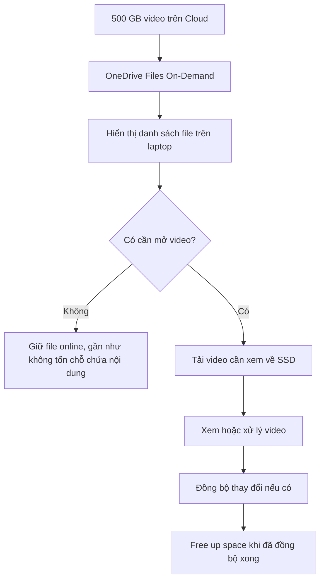

# BÁO CÁO: TỐI ƯU DUNG LƯỢNG LƯU TRỮ VỚI FILES ON-DEMAND

## 1. Mục tiêu

- Sử dụng **Files On-Demand** để tiết kiệm dung lượng SSD trên laptop.
- Lưu trữ và quản lý dữ liệu video giám sát trên Cloud một cách hợp lý.

## 2. Phân tích tình huống

Nhóm có **500 GB video giám sát campus**, nhưng laptop chỉ có **256 GB SSD**. Nếu tải toàn bộ video về máy thì sẽ không đủ chỗ, vì SSD còn phải chứa Windows và các phần mềm khác.

**Giải pháp:** Sử dụng **OneDrive Files On-Demand**. Các file vẫn hiển thị trong thư mục OneDrive, nhưng phần lớn chỉ là file trực tuyến, chưa tải nội dung về SSD. Khi cần xem video nào, nhóm mới tải video đó.

## 3. Cách thiết lập Files On-Demand

**Bước 1: Cài đặt và đăng nhập OneDrive**

- Mở OneDrive trên Windows và đăng nhập tài khoản có đủ dung lượng Cloud.
- Chọn thư mục đồng bộ phù hợp trên máy.

**Bước 2: Bật Files On-Demand**

- Nhấn biểu tượng OneDrive ở thanh tác vụ → **Settings**.
- Trong mục **Sync and backup → Advanced settings**, chọn chế độ **Files On-Demand / Free up disk space** (tên mục có thể khác tùy phiên bản).
- Không chọn giữ toàn bộ 500 GB video trên thiết bị.

**Bước 3: Quản lý các video cần dùng**

- Video chưa cần: nhấn chuột phải → **Free up space** để chỉ lưu trên Cloud.
- Video cần xem khi có Internet: mở file để OneDrive tải về theo nhu cầu.
- Video cần dùng khi mất mạng: nhấn chuột phải → **Always keep on this device**.
- Sau khi làm xong, có thể chọn **Free up space** để giải phóng SSD. Chỉ thực hiện khi file đã đồng bộ thành công.

## 4. Sơ đồ hoạt động

## 5. Báo cáo tính toán dung lượng

Giả sử nhóm chỉ tải **10 GB video** để làm việc và phần dữ liệu hệ thống, ứng dụng, file khác đang dùng **80 GB**. Dung lượng cho thông tin file và bộ nhớ đệm OneDrive được giả sử khoảng **1 GB**.

| Nội dung | Không dùng Files On-Demand | Dùng Files On-Demand |
|---|---:|---:|
| Dữ liệu video cần lưu trên SSD | 500 GB | 10 GB |
| Hệ điều hành, phần mềm và dữ liệu khác (giả sử) | 80 GB | 80 GB |
| Thông tin file/bộ nhớ đệm (ước tính) | Chưa tính | 1 GB |
| Tổng dung lượng cần dùng | Ít nhất 580 GB | Khoảng 91 GB |
| SSD laptop | 256 GB | 256 GB |
| Kết quả | Không đủ dung lượng | Còn khoảng 165 GB |

**Hiệu quả:** Với ví dụ trên, nhóm tránh phải lưu **490 GB nội dung video** trên SSD. Lượng dung lượng thực tế còn trống có thể khác do cách nhà sản xuất tính GB, dung lượng hệ thống và bộ nhớ đệm.

**Lưu ý:** Files On-Demand giúp giảm dung lượng **tải về máy**, chứ không tự giảm dung lượng **500 GB đang lưu trên Cloud**. Nhóm vẫn cần gói Cloud đủ lớn.

## 6. Cách tránh nghẽn mạng và gián đoạn đồng bộ

- **Giới hạn tốc độ tải lên:** Trong cài đặt OneDrive, đặt giới hạn upload phù hợp để không chiếm hết băng thông của nhà trọ (nếu phiên bản ứng dụng hỗ trợ). Ví dụ mạng upload 20 Mbps thì có thể giới hạn khoảng 8–10 Mbps.
- **Chia dữ liệu thành từng đợt:** Không tải 500 GB lên cùng lúc; ưu tiên video quan trọng và tải vào giờ ít người dùng mạng.
- **Giữ laptop hoạt động khi upload:** Cắm sạc, đặt chế độ không tự ngủ khi đang cắm nguồn và giữ kết nối Internet ổn định. Gập máy thường có thể đưa laptop vào chế độ Sleep khiến đồng bộ tạm dừng.
- **Kiểm tra trạng thái:** Chỉ coi video đã sao lưu xong khi OneDrive báo **Up to date** hoặc file hiển thị đã đồng bộ thành công. Nếu mất mạng hay tắt máy, mở lại OneDrive và kiểm tra quá trình đồng bộ tiếp tục; không xóa bản gốc trước khi xác nhận.
- **Sao lưu quan trọng:** Với video không thể quay lại, nên có thêm một bản sao ở ổ cứng ngoài hoặc nơi lưu trữ khác, tránh chỉ phụ thuộc vào một tài khoản Cloud.

## 7. Quản lý vòng đời dữ liệu

1. **Video mới:** Tải lên Cloud theo từng đợt và kiểm tra đã đồng bộ.
2. **Video đang sử dụng:** Chỉ tải về các video nhóm cần xem hoặc chỉnh sửa.
3. **Video ít dùng:** Chuyển về chế độ online-only bằng **Free up space**.
4. **Video hết thời hạn lưu:** Kiểm tra quy định của dự án, quyền riêng tư và thời hạn lưu trữ trước khi xóa; không tự ý xóa dữ liệu giám sát.

## 8. Kết luận

Theo em, **OneDrive Files On-Demand** là giải pháp phù hợp vì laptop 256 GB vẫn có thể truy cập kho video 500 GB trên Cloud mà không cần tải hết về máy. Nhóm chỉ cần tải những video đang dùng, giới hạn tốc độ upload và kiểm tra đồng bộ trước khi xóa bản lưu trên máy. Như vậy vừa tiết kiệm dung lượng SSD, vừa giảm nguy cơ nghẽn mạng và mất dữ liệu.
